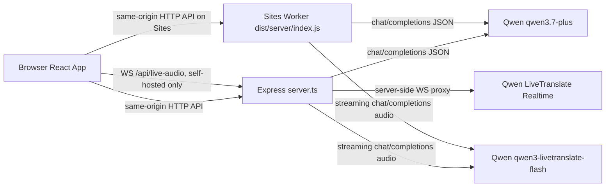

# LectureBridge AI

LectureBridge AI 是一个面向中国留学生的英语授课课堂辅助工具。它的目标不是替代听课，而是在真实课堂中降低认知负担：提前预热课程术语，实时把英文讲课片段转成中文理解层，在听不懂时提供“救生圈”解释，并在课后生成康奈尔笔记、背词卡片和自测题。

当前项目已经从 demo 改造成以 Qwen/千问为核心 AI Provider 的可运行版本。前端是 React + Vite，后端是 Express + OpenAI-compatible Qwen API；同时额外提供 Sites Worker 部署适配，使公开站点可以运行主要 HTTP AI 功能。

公开部署地址：

```text
https://lecturebridge-ai.panorama-estrus.chatgpt.site
```

## 项目定位

这个项目的产品假设是：

- 使用者是正在听英文授课的中文母语学生。
- 课堂场景中最重要的是“实时跟上逻辑”，不是课后才得到完整翻译。
- 术语、上下文、教授口音和长句结构是主要卡点。
- API Key 必须只保存在服务端，浏览器不能直接访问千问。
- 第一版以个人学习工具、本地优先、自托管 Node 服务为主；公开 Sites 站点用于演示和 HTTP 功能验证。

核心体验分为三段：

1. **课前术语预热**：粘贴 syllabus、PPT 大纲或阅读材料，生成中英双语术语库。
2. **课中实时降负**：麦克风或模拟讲课输入产生英文片段，再生成中文要点、难度、上下文桥接和术语解释。
3. **课后复习整理**：把整节课转录整理为康奈尔笔记、双语 flashcards 和 quiz。

## 功能清单

- **课程选择**：内置 Economics、Computer Science、Biology 等示例课程，每门课有初始术语和模拟讲课脚本。
- **邀请码访问门槛**：可选 `INVITE_CODE`；未配置或为 `CHANGE_ME` 时默认不拦截访问。
- **术语预热**：`/api/preload-syllabus` 调用 `qwen3.7-plus` 抽取课程术语。
- **模拟讲课原音**：不需要麦克风，按脚本逐段推送英文 lecture chunk，适合演示和开发测试。
- **本机麦克风听课**：浏览器采集音频，优先走 WebSocket 实时链路；公开 Sites 环境下自动降级到 HTTP 短音频分片。
- **实时中文理解层**：`/api/analyze-chunk` 输出中文核心 takeaway、难度、上下文桥和术语。
- **术语高亮**：英文转录中匹配 glossary term 后高亮，hover 显示中文解释。
- **阶段小结**：`/api/progressive-summary` 把最近若干片段整理为中文阶段总结。
- **听力救生圈**：`/api/rescue-analysis` 对卡住的片段做中文解释、句子拆解、词汇、类比和可问老师的问题。
- **课后学习模式**：`/api/generate-study-notes` 生成康奈尔笔记、flashcards 和 quiz。
- **短音频 HTTP fallback**：`/api/transcribe-audio` 调用 `qwen3-livetranslate-flash` 流式 Chat Completions。
- **公开部署适配**：`scripts/create-sites-worker.mjs` 生成 Sites Worker，支持静态前端和主要 HTTP API。

## 技术栈

| 层 | 技术 | 用途 |
| --- | --- | --- |
| Frontend | React 19 + TypeScript | 单页应用、课堂工作台、状态管理 |
| Build | Vite 6 | 前端开发服务器和生产构建 |
| Styling | Tailwind CSS 4 + custom CSS | 深色玻璃态课堂 UI |
| Icons | `lucide-react` | 导航、按钮、状态图标 |
| Backend | Express 4 | 本地和自托管 API 服务 |
| AI SDK | `openai` | 调用千问 OpenAI-compatible Chat Completions |
| Realtime WS | `ws` | Node 后端代理浏览器和千问实时 WebSocket |
| Deployment Adapter | Sites Worker script | 将 Vite 静态资源和 HTTP API 打包成 Worker 入口 |
| Type Check | TypeScript `tsc --noEmit` | 静态类型检查 |

## 目录结构

```text
.
├── server.ts
├── scripts/
│   └── create-sites-worker.mjs
├── src/
│   ├── App.tsx
│   ├── main.tsx
│   ├── index.css
│   ├── types.ts
│   ├── data/
│   │   └── presetCourses.ts
│   └── components/
│       ├── Navbar.tsx
│       ├── PrivacyBanner.tsx
│       ├── PreheatView.tsx
│       ├── LiveWorkspace.tsx
│       ├── RescueModal.tsx
│       ├── StudyModeView.tsx
│       └── RemoteMicModal.tsx
├── .env.example
├── .openai/
│   └── hosting.json
├── index.html
├── package.json
├── tsconfig.json
├── vite.config.ts
└── README.md
```

关键文件职责：

- `server.ts`：本地/自托管服务入口。负责 Express 路由、Qwen 文本调用、HTTP 音频 fallback、Node WebSocket 实时音频代理、Vite middleware 和生产静态文件服务。
- `scripts/create-sites-worker.mjs`：生产构建后运行，把 `dist/index.html`、`dist/assets/*` 和 Worker API 代码写入 `dist/server/index.js`，用于 Sites 部署。
- `src/App.tsx`：顶层应用状态，包括鉴权、当前视图、课程、术语库、转录、小结、救生圈记录、康奈尔笔记。
- `src/components/PreheatView.tsx`：课前术语预热页面。
- `src/components/LiveWorkspace.tsx`：实时课堂核心页面，包含模拟讲课、麦克风采集、音频上传、转录分析、阶段小结、救生圈入口和术语高亮。
- `src/components/StudyModeView.tsx`：课后复习页面，生成并展示康奈尔笔记、flashcards 和 quiz。
- `src/data/presetCourses.ts`：demo 课程数据，包括 syllabus、初始 glossary 和模拟讲课脚本。
- `src/types.ts`：项目领域对象类型定义。

## 系统架构

本项目有两种运行形态：

1. **Node/Express 形态**：本地开发和自托管推荐形态，功能最完整，包含 WebSocket 实时音频代理。
2. **Sites Worker 形态**：公开部署形态，支持静态页面和 HTTP AI API；由于当前 Sites 边缘层不把 WebSocket Upgrade 请求送入 Worker，公开站点的麦克风实时链路会自动降级到 HTTP 音频分片。

整体调用关系：



## 前端状态模型

顶层状态在 `App.tsx` 中集中维护，传给不同视图组件：

| State | 类型 | 作用 |
| --- | --- | --- |
| `currentView` | `"live" \| "preheat" \| "study"` | 当前页面 |
| `selectedCourse` | `CoursePreset` | 当前课程 |
| `glossary` | `GlossaryTerm[]` | 当前术语库，包含初始词、AI 抽取词、手动新增词 |
| `transcripts` | `TranscriptChunk[]` | 课堂实时转录和中文理解结果 |
| `progressiveSummaries` | `ProgressiveSummary[]` | 阶段小结 |
| `rescueRecords` | `RescueRecord[]` | 听力救生圈历史 |
| `cornellNotes` | `CornellNotes \| null` | 课后复习结果 |
| `isRecording` | `boolean` | 本机麦克风状态 |

当前所有学习数据只存在 React state 和少量 `localStorage` 授权标记里。刷新页面会清空课堂数据。后续如果要真正产品化，应把 glossary、transcripts、notes、rescue records 持久化到 IndexedDB 或服务端数据库。

## 核心数据类型

项目领域类型定义在 `src/types.ts`：

- `GlossaryTerm`：术语条目，包含英文术语、中文翻译、音标、英文定义、中文解释、分类。
- `TranscriptChunk`：课堂转录片段，包含时间戳、英文原文、中文总结、难度、上下文桥、检测到的术语。
- `ProgressiveSummary`：阶段小结，包含时间段、标题、要点、关键概念、快速补课文本。
- `RescueRecord`：救生圈记录，包含原片段、中文解释、句子拆解、建议提问、类比和词汇。
- `CornellNotes`：课后复习产物，包含中文概要、cue questions、Markdown 笔记、flashcards 和 quiz。
- `CoursePreset`：示例课程，包括课程信息、初始 syllabus、初始术语库和模拟讲课脚本。

## Qwen API 设计

所有 Qwen 调用都在服务端执行，浏览器永远不接触 `DASHSCOPE_API_KEY`。

### 文本模型

默认文本模型：

```text
qwen3.7-plus
```

文本类任务统一走 OpenAI-compatible Chat Completions：

```text
POST {QWEN_BASE_URL}/chat/completions
```

当前文本调用策略：

- `temperature: 0.2`
- `response_format: { type: "json_object" }`
- `enable_thinking: false`
- 显式要求模型只返回 JSON
- 服务端 `JSON.parse`
- 服务端对字段做兜底 normalize
- 空输入直接返回 400，不调用 Qwen
- 默认超时由 `QWEN_HTTP_TIMEOUT_MS` 控制

主要 helper：

- `stripJsonFences()`：移除模型偶发返回的 Markdown JSON 代码围栏。
- `parseJson()`：把模型文本解析成 JSON，失败时返回可读错误。
- `qwenJson()`：统一封装文本类 Chat Completions。
- `normalizeTerms()`、`normalizeAnalysis()`、`normalizeSummary()`、`normalizeRescue()`、`normalizeNotes()`：把模型输出整理成前端稳定可消费的数据结构。

### 实时音频模型

自托管 Node 形态的实时音频模型：

```text
qwen3.5-livetranslate-flash-realtime
```

浏览器连接本项目后端：

```text
WS /api/live-audio
```

Node 后端再连接：

```text
{QWEN_REALTIME_WS_URL}?model=qwen3.5-livetranslate-flash-realtime
```

浏览器发送事件：

```json
{
  "type": "audio_chunk",
  "sessionId": "live-...",
  "seq": 1,
  "mimeType": "audio/pcm;rate=16000",
  "base64Audio": "...",
  "courseTitle": "Intro to Machine Learning"
}
```

服务端返回事件：

```json
{
  "type": "transcript",
  "sessionId": "live-...",
  "seq": 1,
  "textEn": "Today we discuss gradient descent...",
  "punctuatedText": "Today we discuss gradient descent...",
  "confidence": 0.95
}
```

服务端错误事件：

```json
{
  "type": "error",
  "sessionId": "live-...",
  "seq": 1,
  "message": "Qwen realtime connection is not ready."
}
```

Node 后端给千问 realtime 的 session 配置包括：

- `modalities: ["text"]`
- `sample_rate: 16000`
- `input_audio_format: "pcm"`
- `input_audio_transcription.model: "qwen3-asr-flash-realtime"`
- `input_audio_transcription.language: "en"`
- `translation.language: "zh"`

### HTTP 短音频 fallback

HTTP fallback 模型：

```text
qwen3-livetranslate-flash
```

这个接口走 OpenAI-compatible streaming Chat Completions：

```text
POST {QWEN_AUDIO_BASE_URL || QWEN_BASE_URL}/chat/completions
```

请求支持两种输入：

1. `audioUrl`：远程音频文件 URL。
2. `base64Audio`：浏览器上传的 base64 音频；纯 base64 会被服务端包装成 `data:{mimeType};base64,...`。

示例请求：

```json
{
  "audioUrl": "https://example.com/sample.wav",
  "format": "wav",
  "sourceLang": "en",
  "targetLang": "en"
}
```

示例响应：

```json
{
  "success": true,
  "text": "Today we discuss gradient descent...",
  "textEn": "Today we discuss gradient descent...",
  "translatedText": "Today we discuss gradient descent..."
}
```

注意：阿里云文档说明 `qwen3-livetranslate-flash` HTTP 音视频翻译接口主要使用工作空间专属 OpenAI-compatible 域名。默认 `https://dashscope.aliyuncs.com/compatible-mode/v1` 可用于文本模型，但音频 HTTP 模型在不同账号/区域下可能需要单独设置 `QWEN_AUDIO_BASE_URL`。

## 主要 API 路由

所有路由均为 same-origin，前端直接 `fetch("/api/...")`。

| Method | Route | 输入 | 输出 | Qwen 模型 |
| --- | --- | --- | --- | --- |
| `GET` | `/api/health` | 无 | 服务状态、模型名、是否配置 Key | 无 |
| `POST` | `/api/auth/verify` | `{ code }` | 是否通过邀请码 | 无 |
| `POST` | `/api/preload-syllabus` | `{ courseTitle, rawContent }` | `terms[]` | `qwen3.7-plus` |
| `POST` | `/api/analyze-chunk` | `{ transcriptChunk, courseTitle, activeGlossary }` | `analysis` | `qwen3.7-plus` |
| `POST` | `/api/progressive-summary` | `{ transcripts, courseTitle, minuteBlock }` | `summary` | `qwen3.7-plus` |
| `POST` | `/api/rescue-analysis` | `{ snippetText, courseTitle, timestamp }` | `rescueData` | `qwen3.7-plus` |
| `POST` | `/api/generate-study-notes` | `{ fullTranscripts, courseTitle }` | `notesData` | `qwen3.7-plus` |
| `POST` | `/api/transcribe-audio` | `{ base64Audio/audioUrl, mimeType, format, sourceLang, targetLang }` | `text` | `qwen3-livetranslate-flash` |
| `WS` | `/api/live-audio` | audio chunk events | transcript/error events | `qwen3.5-livetranslate-flash-realtime` |

## 关键用户流程

### 1. 首次进入

1. `App.tsx` 调用 `/api/auth/verify`，先用空 code 检查是否启用邀请码。
2. 如果 `INVITE_CODE` 未配置或等于 `CHANGE_ME`，直接进入应用。
3. 如果启用邀请码，用户输入 code，通过后写入 `localStorage["lecturebridge-authorized"] = "true"`。

### 2. 课前术语预热

1. 用户进入 `PreheatView`。
2. 粘贴 syllabus、PPT 大纲或阅读材料。
3. 点击“AI 智能抽取专有名词与词汇”。
4. 前端调用 `/api/preload-syllabus`。
5. 服务端用 Qwen 返回 `terms[]`。
6. 前端按 `term.toLowerCase()` 去重后合并到当前 glossary。

### 3. 模拟讲课

1. 用户在 `LiveWorkspace` 点击“模拟讲课原音”。
2. 前端每 5 秒从 `selectedCourse.simulatedAudioScript` 取一个片段。
3. 每个片段调用 `/api/analyze-chunk`。
4. 成功时使用 Qwen 返回的中文理解结果；失败时回落到 preset 里的 demo summary。
5. 每 4 个 chunk 触发一次阶段小结。

### 4. 本机麦克风

1. 用户点击“开启本机麦克风听课”。
2. 前端先尝试连接 `WS /api/live-audio`。
3. 如果 WebSocket 可用，进入实时 WS 模式。
4. 如果 WebSocket 不可用，自动切换到 HTTP 分片模式。
5. 浏览器通过 Web Audio API 获取麦克风输入。
6. 音频被降采样为 16kHz PCM16。
7. WS 模式下按约 1 秒 chunk 发送 PCM base64。
8. HTTP fallback 模式下按约 3 秒 chunk 封装成 WAV base64，调用 `/api/transcribe-audio`。
9. 得到英文转写后统一调用 `/api/analyze-chunk` 生成中文理解层。

### 5. 听力救生圈

1. 用户点击“听力救生圈”。
2. 默认取最近一个 transcript chunk；也可以传入指定 snippet。
3. 前端调用 `/api/rescue-analysis`。
4. Qwen 返回中文解释、句子拆解、词汇、类比和建议提问。
5. 结果进入 modal，同时写入 `rescueRecords`。

### 6. 课后复习

1. 用户进入 `StudyModeView`。
2. 点击生成康奈尔笔记。
3. 如果有真实 transcripts，使用真实转录；否则使用当前课程的 simulated script。
4. 前端调用 `/api/generate-study-notes`。
5. 结果展示为 Cornell Notes、flashcards、quiz 三个 tab。
6. 用户可复制 Markdown 版笔记。

## 音频实现细节

### 浏览器音频采集

`LiveWorkspace.tsx` 使用：

- `navigator.mediaDevices.getUserMedia({ audio: true })`
- `AudioContext`
- `createMediaStreamSource`
- `createScriptProcessor(4096, 1, 1)`
- 静音 `GainNode` 防止麦克风回放到扬声器

原始 float PCM 会被：

1. 从浏览器采样率降采样到 16kHz。
2. 从 `Float32Array` 转成 `Int16Array`。
3. 合并成固定阈值 chunk。
4. 编码为 base64。

### WebSocket 模式

WS 模式发送的是裸 PCM16：

```json
{
  "mimeType": "audio/pcm;rate=16000",
  "base64Audio": "..."
}
```

适用环境：

- 本地开发：`npm run dev`
- 自托管 Node：`npm run build && npm start`
- 支持 WebSocket Upgrade 的反向代理或 PaaS

### HTTP fallback 模式

HTTP fallback 模式会把 PCM16 包装成 WAV：

- 写入 RIFF header
- 单声道
- 16kHz
- 16-bit PCM

然后调用：

```text
POST /api/transcribe-audio
```

这个模式牺牲低延迟，但保证公开 Sites 部署环境仍能完成“麦克风输入 -> 转写 -> 中文理解层”的闭环。

## Sites 部署适配

项目包含 `.openai/hosting.json`，因此发布时使用 Sites。

Sites 需要 `dist/server/index.js` 作为 Worker 入口。本项目不是原生 Worker 项目，所以通过 `scripts/create-sites-worker.mjs` 在 `npm run build` 后生成 Worker 代码。

构建脚本：

```json
{
  "build": "vite build && esbuild server.ts --bundle --platform=node --format=cjs --packages=external --sourcemap --outfile=dist/server.cjs && node scripts/create-sites-worker.mjs"
}
```

生成物：

```text
dist/
├── index.html
├── assets/
│   ├── index-*.js
│   └── index-*.css
├── server.cjs
├── server.cjs.map
└── server/
    └── index.js
```

`create-sites-worker.mjs` 做了三件事：

1. 扫描 `dist/index.html` 和 `dist/assets/*`。
2. 把静态资源以 base64 嵌入 Worker。
3. 写入一份 Worker 兼容的 HTTP API 实现。

这样公开站点不依赖额外静态资源绑定，根路径 `/` 和前端 assets 都由 Worker 直接返回。

### Sites 形态和 Node 形态的差异

| 能力 | Node/Express | Sites Worker |
| --- | --- | --- |
| 静态前端 | 支持 | 支持 |
| 文本 Qwen API | 支持 | 支持 |
| HTTP 音频 fallback | 支持 | 支持 |
| `WS /api/live-audio` 入站 | 支持，可作为独立 gateway | 当前 Sites 边缘层不支持 |
| 前端麦克风体验 | 实时 WS | 外置 gateway 优先，失败后自动降级 HTTP |
| 本地学习数据 | IndexedDB | IndexedDB |
| 适合用途 | 本地开发、外置音频 gateway | 公开 MVP 与 HTTP AI API |

公开 MVP 的实时链路如下：

```text
Sites 前端
  ├─ POST /api/live-audio-token ──> Sites Worker 签发 120 秒 HMAC token
  ├─ WS /api/live-audio?token=... ──> 外置 Node gateway ──> Qwen Realtime
  └─ POST /api/transcribe-audio ──> Sites Worker ──> Qwen HTTP（fallback）
```

Sites Worker 和外置 gateway 必须配置相同的
`AUDIO_GATEWAY_SHARED_SECRET`。API Key 只配置在 Worker 和 gateway 的服务端环境，
不会进入 token 或浏览器 bundle。

## 环境变量

复制 `.env.example`：

```bash
cp .env.example .env
```

完整配置：

```env
DASHSCOPE_API_KEY="your_dashscope_api_key"
QWEN_BASE_URL="https://dashscope.aliyuncs.com/compatible-mode/v1"
QWEN_AUDIO_BASE_URL=""
QWEN_REALTIME_WS_URL="wss://dashscope.aliyuncs.com/api-ws/v1/realtime"
QWEN_CHAT_MODEL="qwen3.7-plus"
QWEN_REALTIME_MODEL="qwen3.5-livetranslate-flash-realtime"
QWEN_AUDIO_HTTP_MODEL="qwen3-livetranslate-flash"
QWEN_HTTP_TIMEOUT_MS="45000"
PUBLIC_AUDIO_GATEWAY_URL="wss://audio.example.com"
LIVE_AUDIO_MODE="gateway-first"
HTTP_AUDIO_FALLBACK="true"
AUDIO_GATEWAY_SHARED_SECRET="replace-with-a-long-random-secret"
AUDIO_GATEWAY_ALLOW_DEV_NO_TOKEN="true"
AUDIO_GATEWAY_ONLY="false"
INVITE_CODE="CHANGE_ME"
PORT="3000"
APP_URL="http://localhost:3000"
```

| 变量 | 必填 | 默认值 | 说明 |
| --- | --- | --- | --- |
| `DASHSCOPE_API_KEY` | 是 | 无 | 服务端调用 Qwen 的 API Key。不要写入前端代码或提交到 Git。 |
| `QWEN_BASE_URL` | 否 | `https://dashscope.aliyuncs.com/compatible-mode/v1` | 文本 Chat Completions endpoint。 |
| `QWEN_AUDIO_BASE_URL` | 否 | 回落到 `QWEN_BASE_URL` | HTTP 音频 fallback endpoint。建议在需要时配置工作空间专属域名。 |
| `QWEN_REALTIME_WS_URL` | 否 | `wss://dashscope.aliyuncs.com/api-ws/v1/realtime` | Qwen realtime WebSocket endpoint。 |
| `QWEN_CHAT_MODEL` | 否 | `qwen3.7-plus` | 术语、分析、小结、救生圈、笔记生成模型。 |
| `QWEN_REALTIME_MODEL` | 否 | `qwen3.5-livetranslate-flash-realtime` | 实时听课 WS 模型。 |
| `QWEN_AUDIO_HTTP_MODEL` | 否 | `qwen3-livetranslate-flash` | HTTP 短音频 fallback 模型。 |
| `QWEN_HTTP_TIMEOUT_MS` | 否 | `45000` | 服务端 Qwen HTTP 调用超时时间。 |
| `PUBLIC_AUDIO_GATEWAY_URL` | Sites 实时音频必填 | 空 | 浏览器连接的外置 `wss://` gateway 地址。为空时尝试同源 WS。 |
| `LIVE_AUDIO_MODE` | 否 | `gateway-first` | `gateway-first`、`http-only` 或 `disabled`。 |
| `HTTP_AUDIO_FALLBACK` | 否 | `true` | gateway 连接失败后是否启用 HTTP 音频分片。 |
| `AUDIO_GATEWAY_SHARED_SECRET` | 生产 gateway 必填 | 空 | Sites Worker 签发、Node gateway 校验短期 token 的共享 HMAC 密钥。 |
| `AUDIO_GATEWAY_ALLOW_DEV_NO_TOKEN` | 否 | `true` | 仅本地开发可免 token；生产模式不会启用。 |
| `AUDIO_GATEWAY_ONLY` | 否 | `false` | `true` 时 Node 服务不加载 Vite/静态前端，仅作为音频 gateway。 |
| `INVITE_CODE` | 否 | `CHANGE_ME` | 自托管访问门槛。为空或 `CHANGE_ME` 时不启用。 |
| `PORT` | 否 | `3000` | Express 服务端口。 |
| `APP_URL` | 否 | 无 | 部署地址标记，当前核心逻辑不强依赖。 |

## 安装和运行

### 依赖

推荐 Node.js：

```text
^20.19.0 || >=22.12.0
```

安装依赖：

```bash
npm install
```

### 本地开发

```bash
npm run dev
```

打开：

```text
http://localhost:3000
```

开发模式下，`server.ts` 会创建 Vite middleware，因此前端和 API 都在同一个 origin 上。

### 生产构建

```bash
npm run build
```

启动生产服务：

```bash
npm start
```

生产模式下，`server.ts` 会从 `dist` 提供静态文件，并把非 API 路由 fallback 到 `dist/index.html`。

## npm scripts

| 命令 | 作用 |
| --- | --- |
| `npm run dev` | 启动 Express + Vite middleware 开发服务器 |
| `npm run build` | 构建 Vite 前端、打包 Node server、生成 Sites Worker |
| `npm start` | 运行 `dist/server.cjs` |
| `npm run lint` | 执行 TypeScript 类型检查 |
| `npm run clean` | 删除 `dist` 和旧 `server.js` 构建产物 |

## 本地测试建议

### 1. 类型和构建

```bash
npm run lint
npm run build
```

### 2. 健康检查

```bash
curl http://localhost:3000/api/health
```

预期包含：

```json
{
  "status": "ok",
  "provider": "qwen",
  "chatModel": "qwen3.7-plus",
  "realtimeModel": "qwen3.5-livetranslate-flash-realtime",
  "audioHttpModel": "qwen3-livetranslate-flash"
}
```

### 3. 文本 API

```bash
curl -sS http://localhost:3000/api/analyze-chunk \
  -H "content-type: application/json" \
  -d '{
    "courseTitle": "Intro to Machine Learning",
    "transcriptChunk": "Regularization penalizes complex models to reduce overfitting."
  }'
```

### 4. 空输入保护

```bash
curl -sS http://localhost:3000/api/transcribe-audio \
  -H "content-type: application/json" \
  -d '{}'
```

预期返回 400，不应调用 Qwen。

### 5. HTTP 音频 fallback

```bash
curl -sS http://localhost:3000/api/transcribe-audio \
  -H "content-type: application/json" \
  -d '{
    "audioUrl": "https://help-static-aliyun-doc.aliyuncs.com/file-manage-files/zh-CN/20250211/tixcef/cherry.wav",
    "format": "wav",
    "sourceLang": "zh",
    "targetLang": "en"
  }'
```

如果返回模型/域名错误，通常是 `QWEN_AUDIO_BASE_URL` 需要配置为阿里云百炼工作空间域名。

## 已验证的线上状态

最近一次验证覆盖：

- 公开首页 `/` 返回 HTTP 200。
- `/api/health` 返回 `qwenConfigured: true`。
- `/api/analyze-chunk` 可真实返回中文理解层。
- `/api/progressive-summary` 可真实返回阶段小结。
- `/api/rescue-analysis` 可真实返回救生圈分析。
- `/api/generate-study-notes` 可真实返回康奈尔笔记、flashcards 和 quiz。
- `/api/preload-syllabus` 可真实返回术语列表。
- `/api/transcribe-audio` 可通过官方示例音频 URL 返回文本。
- Sites 上 `WS /api/live-audio` 受边缘层限制不可用，前端会自动使用 HTTP fallback。

## 错误处理策略

后端遵循以下策略：

- `DASHSCOPE_API_KEY` 缺失：返回明确 500 配置错误。
- 空文本或空音频：返回 400，不调用 Qwen，避免浪费成本。
- Qwen HTTP 非 2xx：返回 `{ success: false, error }`，不把完整原始异常栈暴露给前端。
- JSON 解析失败：返回可读错误，例如 `Qwen returned invalid JSON for analyze-chunk.`
- WebSocket 错误：返回结构化 `{ type: "error", message }` 给浏览器。
- 前端对分析失败做局部降级，避免整个课堂页面崩溃。

## 成本控制

当前已经实现：

- 空文本不调用 Qwen。
- 空音频不调用 Qwen。
- 重复 transcript 不重复分析。
- 文本 JSON 调用设置较低 temperature、max token 和超时。
- 模拟讲课按固定间隔推送，不做高频请求。
- HTTP 麦克风 fallback 按较大音频窗口分片，避免过度频繁调用。
- 术语预热、chunk 分析、阶段小结、救生圈和课后笔记按请求内容 hash 缓存到 IndexedDB。
- 相同输入优先读取本地缓存，不重复调用 Qwen。

后续建议：

- 对长 syllabus 做裁剪或分段抽取。
- 为生产环境增加 per-IP/request rate limit。

## 安全和隐私

- API Key 只放在服务端环境变量中。
- 浏览器只访问本项目同源 API。
- 麦克风音频会发送到本项目后端，再转发给 Qwen 服务。
- 当前没有用户账号体系，也没有服务端数据库。
- 课堂 session 与 AI 缓存保存在当前浏览器的 IndexedDB；刷新后可以恢复，但不会跨设备同步。
- 每门课程维护独立的当前 session；新建、清空或切换课程不会覆盖其他课程记录。
- 外置 gateway 只接受有效期 120 秒的 HMAC token；无 token、签名错误或过期连接以 WebSocket `1008` 拒绝。
- 公开 Sites 站点访问权限为 public，任何拿到链接的人都能访问页面。
- 如果配置了 `INVITE_CODE`，只是轻量访问门槛，不等同于完整认证系统。

## 部署说明

### 自托管 Node 推荐路径

自托管是功能最完整的部署方式：

```bash
npm install
cp .env.example .env
npm run build
npm start
```

反向代理需要支持 WebSocket：

```text
GET /api/live-audio
Connection: Upgrade
Upgrade: websocket
```

如果使用 Nginx，需要显式配置 WebSocket Upgrade headers。

### 部署独立音频 gateway

外置 gateway 是同一个 `server.ts` 的精简运行模式：

```env
NODE_ENV="production"
AUDIO_GATEWAY_ONLY="true"
AUDIO_GATEWAY_SHARED_SECRET="与 Sites 完全相同的长随机密钥"
DASHSCOPE_API_KEY="your_dashscope_api_key"
PORT="3000"
```

```bash
npm run build
npm start
```

部署平台必须支持长连接 WebSocket，并为服务配置 HTTPS/WSS 域名。随后在 Sites
环境中设置：

```env
PUBLIC_AUDIO_GATEWAY_URL="wss://audio.example.com"
LIVE_AUDIO_MODE="gateway-first"
HTTP_AUDIO_FALLBACK="true"
AUDIO_GATEWAY_SHARED_SECRET="与 gateway 完全相同的长随机密钥"
```

浏览器启动麦克风时先向 Sites Worker 请求短期 token，再连接 gateway。连接意外
断开后自动重试两次；仍失败且 fallback 开启时切换到 HTTP 分片转写。

### IndexedDB 数据与备份

数据库名为 `lecturebridge-ai`，包含两个 object store：

- `sessions`：完整课堂快照，按 `courseId` 建索引，包含 glossary、transcripts、
  progressive summaries、rescue records 和 Cornell notes。
- `cache`：按 API 路径和稳定请求 hash 保存成功响应，默认有效期 7 天。

页面顶部会显示当前课堂时间和“自动保存在本机”。四个图标依次用于新建课堂、
导出 Markdown、导出 JSON 和导入 JSON。JSON 导入会创建新的 session，不覆盖
原备份或其他课程；Markdown 用于阅读和归档，不支持反向导入。

### Sites 发布路径

Sites 发布使用 `.openai/hosting.json` 中的 `project_id`。不要重复创建站点。

发布流程概念上是：

1. `npm run build`
2. `scripts/create-sites-worker.mjs` 生成 `dist/server/index.js`
3. 用 Sites 打包 `dist`
4. 保存 site version
5. 部署 saved version
6. 设置生产环境变量
7. 重新部署以应用环境变量 revision

不要把 API Key 写入 `.env.example`、README 或源码。

## 常见问题排查

### 首页 404

检查 `dist/server/index.js` 是否由 `scripts/create-sites-worker.mjs` 生成，并确认静态资源已嵌入 Worker。之前的根路径 404 是因为 Worker 没有服务 `index.html` 和 assets。

### 文本 API 超时

可能原因：

- syllabus 太长。
- 模型响应慢。
- `QWEN_HTTP_TIMEOUT_MS` 太短。
- prompt 输出字段过多。

处理方式：

- 缩短输入。
- 增大 `QWEN_HTTP_TIMEOUT_MS`。
- 检查 `QWEN_BASE_URL` 是否是当前区域推荐域名。

### `qwen3-livetranslate-flash` HTTP 音频失败

优先检查：

- `QWEN_AUDIO_BASE_URL` 是否需要配置工作空间专属域名。
- `format` 是否正确，例如 `wav`、`mp3`。
- `base64Audio` 是否为空。
- 音频 URL 是否公网可访问。

### Sites 上 WebSocket 返回 500

不要把 `PUBLIC_AUDIO_GATEWAY_URL` 指向 Sites 自身。Sites 的入站 WebSocket
Upgrade 当前不会进入 Worker 业务代码。应部署外置 Node gateway 并配置其
`wss://` 地址；未配置或 gateway 不可用时，前端会使用 HTTP fallback。

### Gateway 返回 1008

`1008 Invalid or expired gateway token` 表示鉴权失败。确认 Sites 和 gateway
配置了完全相同的 `AUDIO_GATEWAY_SHARED_SECRET`，两台服务器系统时间准确，
并且浏览器通过 `/api/live-audio-token` 获取了新 token。

### 本地被代理影响

如果本机有失效代理环境变量，例如 `127.0.0.1:7897`，网络命令可能失败。临时绕过：

```bash
ALL_PROXY= HTTPS_PROXY= HTTP_PROXY= NO_PROXY= curl https://example.com
```

### 邀请码一直错误

检查：

- 生产环境 `INVITE_CODE` 是否设置。
- 浏览器 `localStorage["lecturebridge-authorized"]` 是否残留旧状态。
- `/api/auth/verify` 是否返回 `accessRequired: true`。

## 后续落地路线

建议按优先级推进：

1. **部署 gateway**：选择支持 Node WebSocket 的生产平台并配置独立域名、健康检查和共享 secret。
2. **课程管理**：允许用户创建课程、编辑课程元数据，而不局限于 preset。
3. **权限**：把邀请码升级为账号或一次性 invite token，并加入 API rate limit。
4. **导出扩展**：支持 PDF、Anki CSV、Notion/Obsidian 格式。
5. **可观测性**：增加请求耗时、模型错误分类、网关连接数和成本估算。
6. **自动测试**：补 IndexedDB 单元测试、前端交互测试和音频 fallback 集成测试。

## 官方文档参考

- Qwen OpenAI-compatible API: https://platform.qianwenai.com/docs/api-reference/toolkitframework/openai-compatible/overview
- Qwen structured output: https://platform.qianwenai.com/docs/developer-guides/text-generation/structured-output
- Qwen realtime translation: https://platform.qianwenai.com/docs/developer-guides/speech/realtime-translation
- Alibaba Cloud `qwen3-livetranslate-flash` API: https://help.aliyun.com/en/model-studio/qwen3-livetranslate-flash-api
- Alibaba Cloud realtime client events: https://help.aliyun.com/en/model-studio/live-translator-client-events

## License

当前仓库没有包含 license 文件。在公开分发、商用或开源前，请补充明确的许可证。
